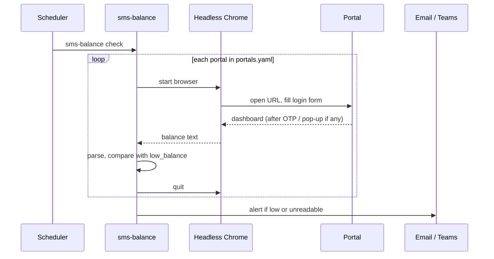

# SMS Balance Monitor

[](https://github.com/NurMohammad126641/sms-balance-monitor/actions/workflows/ci.yml)


**A config-driven Selenium bot that logs in to SMS gateway portals, reads the remaining credit
and alerts the team before it runs out.** Bulk SMS carries OTPs, transaction receipts and alerts
for a payments app, so an empty balance turns into a customer-facing outage. These portals offer
no API, so the bot reads the balance the way a person would: by logging in.

> **Where this comes from:** at TallyKhata (Progoti Systems) this replaced a manual daily check of
> several SMS gateway accounts. This public version is rebuilt around a config file. Portals are
> described in YAML, credentials come only from environment variables, the retired Skype
> integration is replaced with Microsoft Teams, and the browser tests run against a local
> fixture page instead of a real portal.

## Features

- **One YAML entry per portal:** URL, CSS or XPath selectors, low-balance threshold and currency.
  Adding a portal needs no code changes.
- **Handles real-world portals:** submit buttons or Enter, JavaScript alerts after login, "Agree"
  pop-ups, balances that only appear on hover, and an **OTP step** where the bot waits in a
  visible browser for a person to type the code.
- **Robust parsing:** currency symbols, labels, Western and South Asian digit grouping
  (`1,23,456.50`), and Bangla digits (`৪২,০০০.৭৫`).
- **Failure isolation:** one portal timing out is reported as "unreadable" and the others are
  still checked. The browser is always closed, even on errors.
- **Alerts that matter:** an `[ACTION NEEDED]` email or Teams message goes out only when a balance
  is low or a portal could not be read. Use `--always-send` for a daily summary.
- **Scheduler-friendly:** the exit code is non-zero when a portal could not be read.

## Quick start

```bash
git clone https://github.com/NurMohammad126641/sms-balance-monitor.git
cd sms-balance-monitor
pip install -e ".[dev]"

cp .env.example .env               # add each portal's username/password and the alert settings
# edit config/portals.yaml         # URLs, selectors and thresholds for your portals

sms-balance list
sms-balance check --no-alerts      # headless; prints the readings
sms-balance check --headed         # visible browser, for portals that ask for an OTP
```

Example output:

```text
[ACTION NEEDED] SMS balance: 1 low
Bulk SMS (primary account): 48,250.00 BDT
Bulk SMS (backup account): 1,180.50 BDT  <-- LOW
```

## Describing a portal

```yaml
portals:
  - name: api_sms_gateway
    label: API SMS gateway
    url: https://gateway.example.com/signin
    username_env: GATEWAY_SMS_USER          # only the variable names live in the config
    password_env: GATEWAY_SMS_PASSWORD
    low_balance: 10000
    otp:                                    # optional
      page_url_contains: /verify-otp
      done_url_contains: /home
      timeout_seconds: 300
    selectors:
      username: "#username"
      password: "#password"
      dismiss: ["xpath://button[span[contains(text(), 'Agree')]]"]
      hover_before_balance: "xpath://span[@aria-label='dollar']"
      balance: "xpath://div[contains(text(), 'API Balance')]//strong"
```

## How it works



## Testing

```bash
pytest          # parsing, config and alert logic, plus browser tests when Chrome is installed
ruff check .
```

The browser tests drive real headless Chrome against
[`tests/fixtures/portal.html`](tests/fixtures/portal.html), a fake portal with a login form, a
terms pop-up and a hover-only balance. That way the Selenium flow is tested end to end in CI
without touching a real SMS provider. A [gitleaks](https://github.com/gitleaks/gitleaks) secret
scan also runs on every push.

## Project layout

```text
config/portals.yaml       portal definitions (no credentials)
src/sms_balance/
  cli.py                  `sms-balance list` / `sms-balance check`
  config.py               YAML loading; credentials from the environment
  portal.py               the Selenium flow for one portal
  parsing.py              balance text -> Decimal
  monitor.py              check every portal, build the message
  alerts.py               email (STARTTLS/SSL) and Teams webhook
tests/                    unit tests + browser tests with a local fixture page
```

## Tech stack

Python · Selenium 4 (Selenium Manager) · headless Chrome · SMTP · Microsoft Teams webhooks ·
pytest · GitHub Actions

## Author

**Nur Mohammad Siddiq**, Data, BI & Automation Engineer.
[LinkedIn](https://www.linkedin.com/in/nur-mohammad-siddiq-9a73931b6) · [GitHub](https://github.com/NurMohammad126641)
